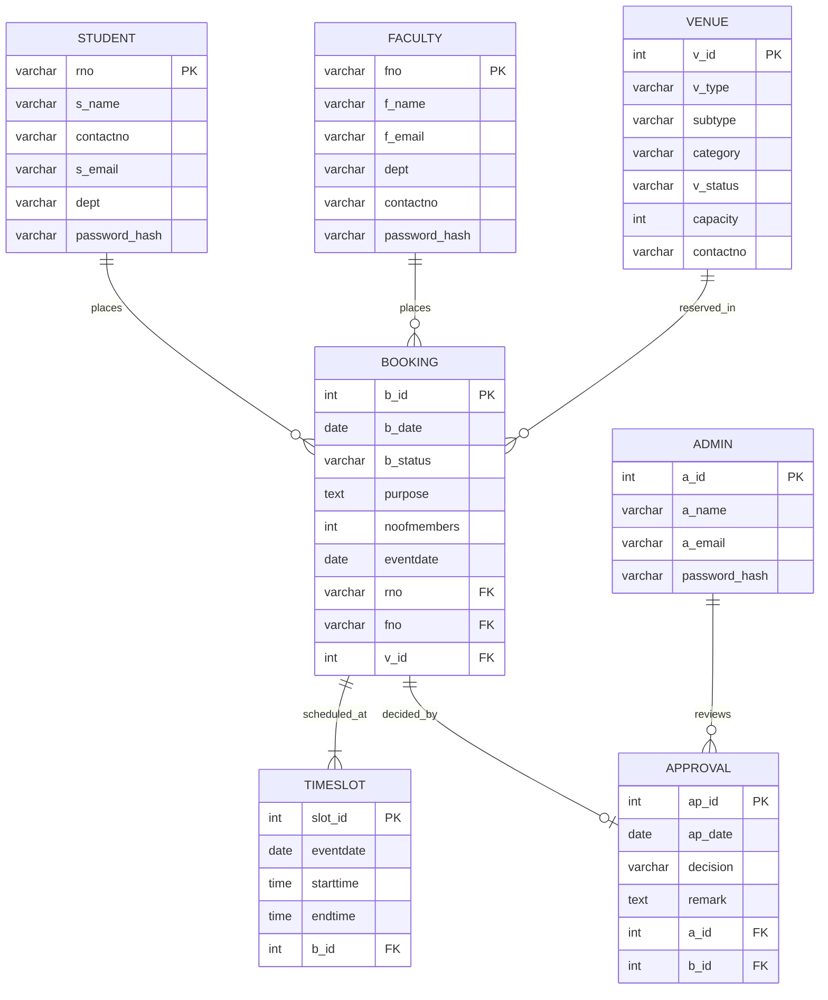

# vAccess — College Venue Booking & Approval Management System

[](https://nodejs.org/)
[](https://expressjs.com/)
[](https://supabase.com/)
[]()
[]()
[]()

> A full-stack, enterprise-grade College Venue Booking and Administrative Approval Governance System built with **Vanilla HTML5, CSS3, modern JavaScript (ES6+)**, a **Node.js/Express backend**, and **PostgreSQL hosted on Supabase**.

---

## 🏛️ Project Overview

**vAccess** streamlines how campus community members (students and faculty) discover and reserve campus infrastructure (auditoriums, seminar halls, computer labs, conference rooms, indoor stadiums) and provides college administrators with a robust, auditable approval pipeline with transaction-safe decisions and conflict detection.

### 🌟 Key Highlights
- **Two Tailored Portals**:
  - **Student & Faculty Portal**: Browse campus venues, verify real-time slot availability, submit 4-step reservation requests, track approval lifecycle status, and receive real-time notifications.
  - **Admin Approval & Governance Portal**: High-level administrative dashboard, urgent pending approval queue, decision modals with mandatory audit remarks, live conflict re-validation, venue status management, and complete student & faculty directories.
- **Strict ER Model Implementation**: Built directly upon the authoritative College Venue Booking ER Model (`student`, `faculty`, `venue`, `booking`, `timeslot`, `approval`, `admin`, `session`).
- **PostgreSQL on Supabase**: Live database persistence using transaction isolation, row locking (`FOR UPDATE`), and foreign-key integrity.
- **Zero Framework Bloat**: Pure semantic HTML5, custom CSS design tokens, and modular ES6 JavaScript with zero React, Vue, or Tailwind dependencies for lightning-fast load times.
- **Automated Verification**: End-to-end test suite verifying access control, decision state machines, timeslot conflicts, and live notification streams.

---

## 🔑 Live Database Accounts & Credentials

The application is connected directly to PostgreSQL on **Supabase**. The following authenticated accounts are pre-seeded in the database:

### 🛡️ Administrators (`admin` table)
| Admin ID (`a_id`) | Administrator Name | Email Address | Default Password | Role | Permissions |
| :---: | :--- | :--- | :---: | :---: | :--- |
| **`1`** | Admin One | `admin1@example.com` | `Admin@123` | `admin` | Full System Access, Booking Approvals, Venue Management |
| **`2`** | Admin Two | `admin2@example.com` | `Admin@123` | `admin` | Full System Access, Booking Approvals, Venue Management |
| **`3`** | Administrator | `admin@vaccess.edu` | `Admin@123` | `admin` | Primary System Administrator, Audit Log Review |

### 👨‍🏫 Faculty Members (`faculty` table)
| Faculty ID (`fno`) | Faculty Name | Email Address | Department | Contact Number | Default Password |
| :---: | :--- | :--- | :--- | :---: | :---: |
| **`F001`** | Dr. Rajesh Deshmukh | `rajesh.deshmukh@example.com` | Computer Engineering | 9876500010 | `Faculty@123` |
| **`F002`** | Prof. Neha Shah | `neha.shah@example.com` | Information Technology | 9876500011 | `Faculty@123` |
| **`F003`** | Dr. Amit Joshi | `amit.joshi@example.com` | Electronics Engineering | 9876500012 | `Faculty@123` |
| **`F004`** | Prof. Sneha Patil | `sneha.patil@example.com` | Computer Engineering | 9876500013 | `Faculty@123` |
| **`F101`** | Dr. Sarah Jenkins | `sarah.jenkins@vaccess.edu` | Computer Science | 9811223344 | `Faculty@123` |

### 🎓 Students (`student` table)
| Roll No (`rno`) | Student Name | Email Address | Department | Contact Number | Default Password |
| :---: | :--- | :--- | :--- | :---: | :---: |
| **`S001`** | Taswi Tawde | `taswi.tawde@example.com` | Computer Science | 1234567890 | `Student@123` |
| **`S101`** | Alex Mercer | `alex.mercer@vaccess.edu` | Computer Science | 9876543210 | `Student@123` |
| **`ST001`** | Aarav Sharma | `aarav.sharma@example.com` | Computer Engineering | 9876543210 | `Student@123` |
| **`ST002`** | Ananya Patil | `ananya.patil@example.com` | Information Technology | 9876543211 | `Student@123` |
| **`ST003`** | Rohan Mehta | `rohan.mehta@example.com` | Computer Engineering | 9876543212 | `Student@123` |
| **`ST004`** | Isha Kulkarni | `isha.kulkarni@example.com` | Electronics Engineering | 9876543213 | `Student@123` |
| **`ST005`** | Vedant Joshi | `vedant.joshi@example.com` | Computer Engineering | 9876543214 | `Student@123` |

> 📖 **Full User Directory & Detailed Permissions**: See [USERS_DIRECTORY.md](USERS_DIRECTORY.md)  
> 🛠️ **Engineering Report & Change Log**: See [CHANGES_AND_FIXES.md](CHANGES_AND_FIXES.md)

---

## 🚀 Getting Started & Local Setup

### 1. Prerequisites
- **Node.js** v18.0.0 or higher
- **npm** v9.0.0 or higher
- Git

### 2. Clone the Repository
```bash
git clone https://github.com/harshadp18/Vaccess.git
cd Vaccess
```

### 3. Install Dependencies
```bash
npm install
```

### 4. Configure Environment Variables
Copy `.env.example` to `.env`:
```bash
cp .env.example .env
```
Ensure your `.env` contains your Supabase PostgreSQL credentials:
```env
PORT=3000
DB_HOST=aws-0-ap-northeast-2.pooler.supabase.com
DB_NAME=postgres
DB_USER=your_db_user
DB_PASSWORD=your_db_password
DB_PORT=5432
SESSION_SECRET=your_secret_key
```

### 5. Launch the Application
```bash
npm start
```
The server will start on: **`http://localhost:3000`**

Open your web browser and navigate to:
- **Landing Page**: `http://localhost:3000`
- **Login Portal**: `http://localhost:3000/pages/login.html`

---

## 🧩 Relational Database ER Model

The database schema strictly implements the normalized College Venue Booking ER architecture:



---

## 📡 REST API Documentation

### 🔐 Authentication (`/api/auth`)
| Method | Endpoint | Description | Auth Required |
| :--- | :--- | :--- | :---: |
| `POST` | `/api/auth/login` | Multi-role user authentication with bcrypt | No |
| `POST` | `/api/auth/logout` | Destroys server session & clears cookie | Yes |
| `GET` | `/api/auth/me` | Fetches active user session & profile | Yes |

### 📅 Bookings & Timeslots (`/api/bookings`)
| Method | Endpoint | Description | Auth Required |
| :--- | :--- | :--- | :---: |
| `POST` | `/api/bookings` | Submits a new booking with slot conflict check | Yes |
| `GET` | `/api/bookings` | Fetches user bookings or all filterable bookings | Yes |
| `GET` | `/api/bookings/:id` | Fetches full booking details with requester info | Yes |
| `POST` | `/api/bookings/:id/cancel` | Cancels a pending or approved booking | Yes |

### 🛡️ Administration & Approvals (`/api/admin`)
| Method | Endpoint | Description | Auth Required |
| :--- | :--- | :--- | :---: |
| `POST` | `/api/bookings/:id/approve` | Approves booking, creates approval audit record | Admin |
| `POST` | `/api/bookings/:id/reject` | Rejects booking with required audit remark | Admin |
| `GET` | `/api/admin/bookings` | Fetches all bookings with status & date filters | Admin |
| `GET` | `/api/admin/dashboard` | Returns aggregated metrics & pending totals | Admin |
| `GET` | `/api/admin/faculty` | Retrieves complete faculty member directory | Admin |
| `GET` | `/api/admin/students` | Retrieves complete student directory | Admin |

### 🏛️ Venues & Inventory (`/api/venues`)
| Method | Endpoint | Description | Auth Required |
| :--- | :--- | :--- | :---: |
| `GET` | `/api/venues` | Fetches all venues with capacity and status | No |
| `GET` | `/api/venues/:id` | Fetches detailed venue information | No |
| `GET` | `/api/venues/available` | Queries venues available for specific slot | No |

### 🔔 Notifications (`/api/notifications`)
| Method | Endpoint | Description | Auth Required |
| :--- | :--- | :--- | :---: |
| `GET` | `/api/notifications` | Returns live role-filtered notification feed | Yes |

---

## 🧪 Automated Testing

vAccess features a dedicated test suite using Node's built-in test runner (`node:test`):

```bash
npm test
```

### Test Coverage Highlights
- **Access Control Enforcement**: Verifies that unauthenticated or non-admin requests receive `401 Unauthorized` or `403 Forbidden`.
- **Atomic Decision Transactions**: Validates that decisions rollback on missing remark, missing ID, or non-pending statuses.
- **Concurrency & Conflict Detection**: Verifies that timeslot collisions are detected and blocked.
- **Live Notifications**: Verifies role-based notification filtering for students, faculty, and administrators.

---

## 📂 Project Directory Structure

```text
vAccess/
├── server.js                      # Express server entry point & middleware pipeline
├── package.json                   # Project metadata and dependencies
├── .env.example                   # Environment configuration template
├── README.md                      # Primary project documentation
├── USERS_DIRECTORY.md             # Authoritative user directory & credentials
├── CHANGES_AND_FIXES.md           # Engineering report & change changelog
├── config/
│   └── db.js                      # PostgreSQL connection pool with Supabase SSL
├── routes/
│   ├── admin.js                   # Administrative approvals, rejections, directories
│   ├── auth.js                    # Multi-role authentication & session handling
│   ├── bookings.js                # Booking reservation & timeslot management
│   ├── notifications.js           # Live notification feed derived from bookings
│   └── venue.js                   # Campus venue directory and availability checks
├── js/
│   ├── api.js                     # Centralized client API client with caching
│   ├── app.js                     # Bootstrap, sidebar initialization, active links
│   ├── auth.js                    # Role guards (requireLogin, requireAdmin)
│   ├── bookings.js                # Client booking helpers and statistics
│   ├── notifications.js           # Client notification rendering and badge counter
│   ├── utils.js                   # Date formatters, modals, toasts, dialogs
│   └── venues.js                  # Venue filtering and display helpers
├── css/
│   ├── style.css                  # Design tokens, color system, CSS variables
│   ├── components.css             # Buttons, badges, tables, modals, cards, forms
│   ├── dashboard.css              # Dashboard layouts, timelines, step wizards
│   └── responsive.css             # Responsive breakpoints for mobile & tablet
├── pages/
│   ├── login.html                 # Multi-role login screen with helper chips
│   ├── register.html              # Account registration for students & faculty
│   ├── student-dashboard.html     # Student & faculty dashboard
│   ├── booking.html               # 4-Step interactive booking wizard
│   ├── booking-details.html       # Requester booking inspection & timeline
│   ├── my-bookings.html           # Requester booking history with cancellation
│   ├── venues.html                # Campus venue catalog with filters
│   ├── notifications.html         # Unified notification center (Student/Faculty/Admin)
│   ├── profile.html               # User profile manager & system stats
│   ├── admin-dashboard.html       # Administrative control center & pending queue
│   ├── admin-bookings.html        # Admin booking directory with CSV export
│   ├── admin-booking-details.html # Admin decision panel (Approve / Reject)
│   ├── admin-venues.html          # Campus venue inventory & maintenance
│   ├── admin-students.html        # Student directory with booking records
│   ├── admin-faculty.html         # Faculty directory with booking records
│   ├── admin-approvals.html       # Administrative decision audit log
│   ├── admin-admins.html          # Administrator accounts roster
│   └── admin-er-model.html        # Interactive ER Model & Database viewer
└── tests/
    ├── approval_workflow.test.js  # 14 Approval/Rejection workflow unit tests
    └── notifications.test.js      # 2 Live notification unit tests
```

---

## 🎨 Design System & Accessibility

- **Color Tokens**:
  - Primary Navy: `#0a192f` / `#1e3a8a` / `#2563eb`
  - Pending Warning: `#d97706`
  - Approved / Available: `#16a34a`
  - Rejected / Danger: `#dc2626`
  - Surface Background: `#f8fafc` / Card Surface: `#ffffff`
- **Accessibility**: Semantic HTML landmarks (`<nav>`, `<aside>`, `<main>`, `<header>`), accessible ARIA modals, high-contrast typography, and focus ring states.
- **Responsiveness**: Fluid layout across mobile devices (≤640px), tablets (≤900px), and wide monitors.

---

## 📄 License
This project is licensed under the MIT License — academic and institutional use permitted.
